# Azure Container Apps and Microsoft Entra ID

Use a private Azure Container Registry image and require Microsoft Entra sign-in at Azure Container Apps ingress. The app displays whether ACA supplied an authenticated principal. The **Signed-in user** panel shows selected claims when available, including name, sign-in name, identity provider, user object ID and tenant ID.

## Before you start

Use an Azure subscription and a Microsoft Entra tenant you can administer. You need permission to create the Azure resources and grant `AcrPull` on the registry, plus permission to create an app registration and configure its enterprise application and user assignment. Open Azure Cloud Shell in Bash mode.

## 1. Select the subscription and deploy the image

```bash
export SUBSCRIPTION='<your-subscription-id>'
export ACR='<globally-unique-lowercase-registry-name>'
git clone https://github.com/kramit/aca-entra-auth-demo.git
cd aca-entra-auth-demo
bash deploy.sh
```

The script creates a dedicated resource group in UK South and an Azure Container Registry on the Basic tier. It enables ARM-audience authentication and leaves the registry admin account disabled. ACR Tasks builds the image from the Dockerfile and tags it with the Git commit. Copy the printed digest for the revision check.

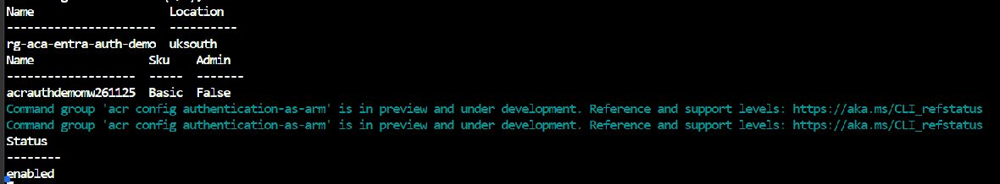

*Cloud Shell confirms the resource group and private registry settings.*

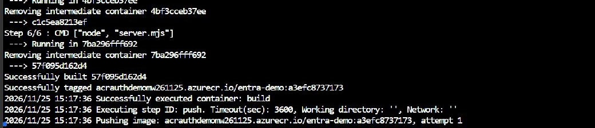

*The registry builds the demo from the repository checkout.*

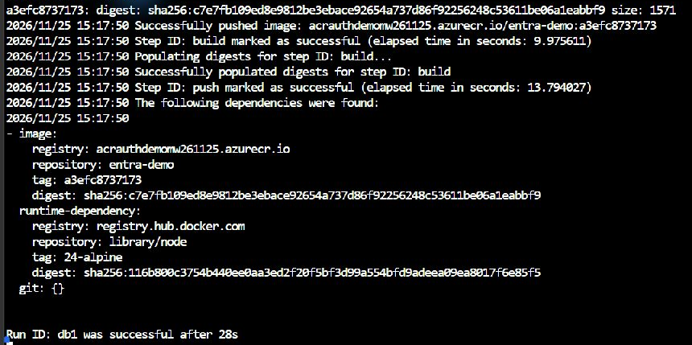

*The pushed image digest identifies exactly what ACA will run.*

The script grants the app's user-assigned managed identity `AcrPull` at the registry scope. It deploys the image by digest to a Consumption workload profile, using 0.25 vCPU, 0.5 GiB memory and zero to one replicas. It enables external HTTPS ingress on target port 8080. It then lists the revision and the deployed image reference. Open the HTTPS hostname returned by the script. The baseline should read **Anonymous**.

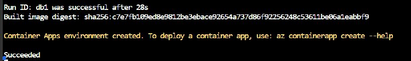

*The Consumption environment is ready for the first revision.*

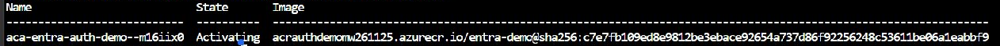

*During deployment, the revision activates using the immutable registry image reference.*

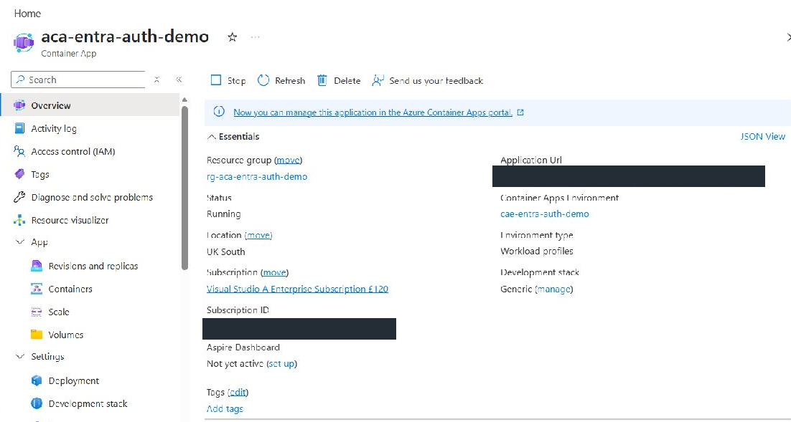

*The ACA overview gives you the Application URL to open for the baseline.*

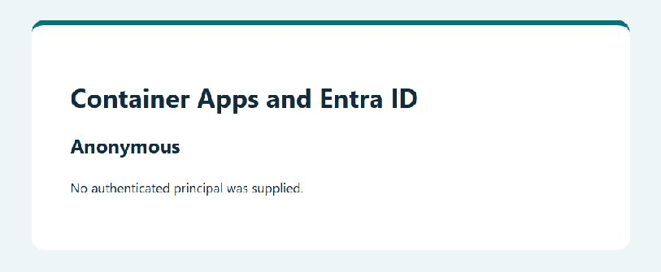

*The baseline request reaches the app without an authenticated principal.*

### Verify the deployment in the Azure portal

Open the registry and select **Access control (IAM) > Role assignments**. Search for the demo managed identity and verify that **AcrPull** is scoped to **This resource**.

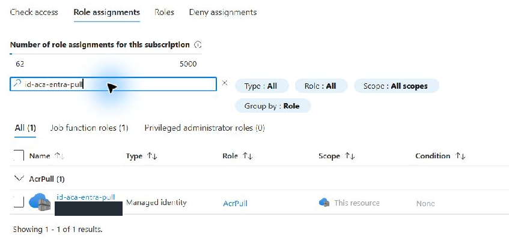

*The managed identity can pull images from this registry.*

Open the Container App's **Ingress** blade. The app accepts traffic from outside its environment using HTTP ingress. Check that **Insecure connections** is clear and the **Target port** is 8080. Clients connect over HTTPS and ACA forwards the request to the container's target port.

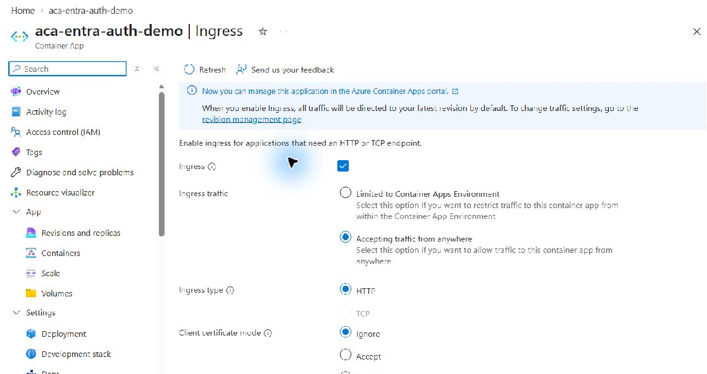

*External ingress gives the class a browser-accessible endpoint.*

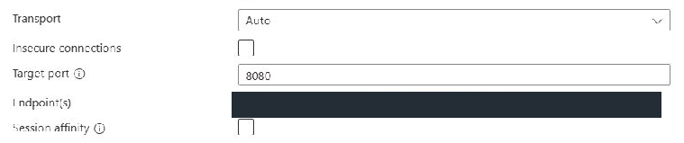

*ACA terminates HTTPS and forwards traffic to the application's listening port.*

Open **App > Scale** and check that the minimum is zero and the maximum is one.

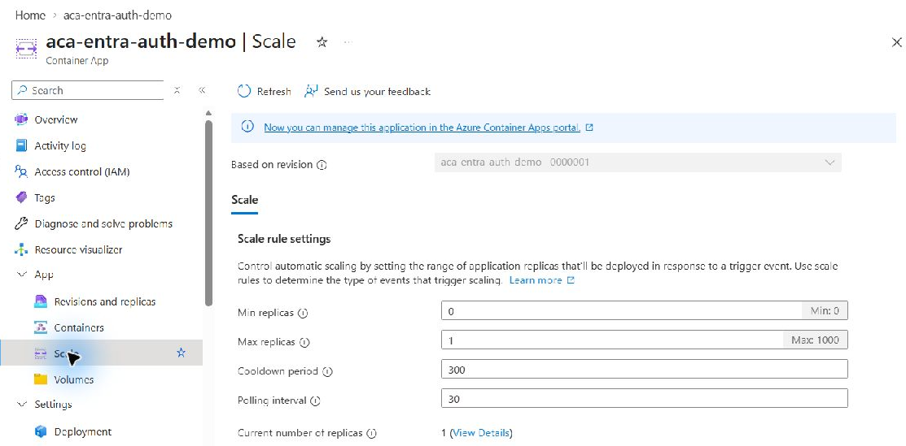

*The Consumption app can scale to zero after requests stop.*

## 2. Enable Microsoft Entra authentication

### Open the identity provider form

Open the container app in the Azure portal. Under **Security > Authentication**, select **Add identity provider**.

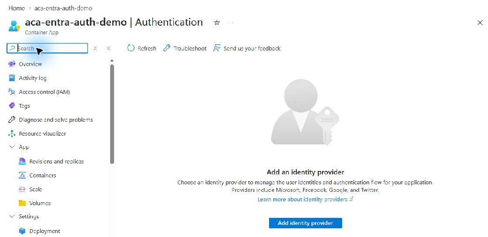

*This is the platform authentication configuration for the container app.*

### Create a Microsoft registration

Select **Microsoft** and **Workforce**. Create a new app registration in the current tenant and choose the recommended 180-day client-secret expiry.

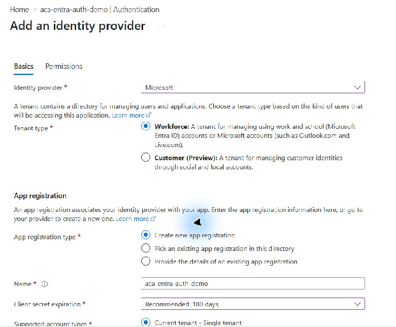

*The portal creates the registration and stores its credential in ACA.*

### Restrict the registration to your tenant

Confirm **Current tenant – Single tenant** under **Supported account types**.

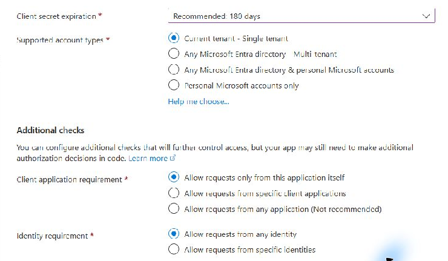

*This registration accepts accounts from the current directory.*

### Require browser sign-in

Choose **Require authentication** and **HTTP 302 Found redirect**, with Microsoft as the provider. Select **Add**.

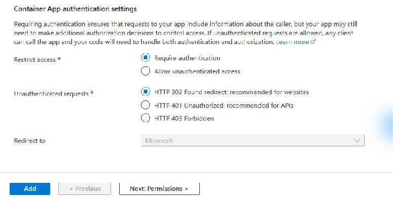

*An anonymous browser request will start the Microsoft sign-in flow.*

### Confirm the saved settings

Check that the Authentication blade shows **Enabled** and **Require authentication**. Open the registration link in the Microsoft provider row.

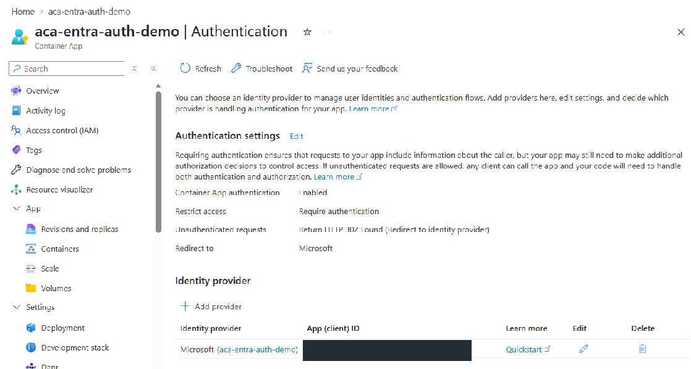

*The saved configuration matches the form selections.*

### Confirm the Web callback

In the app registration, open **Authentication**. Check the Web redirect URI follows the format `https://<app-hostname>/.auth/login/aad/callback`. On **Overview**, open the link under **Managed application in local directory**.

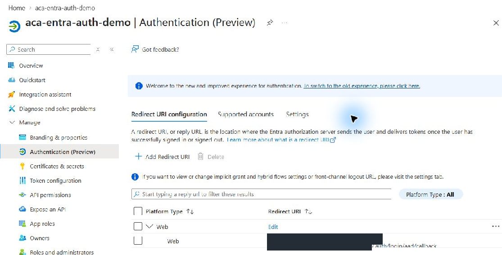

*Entra sends the browser back to the ACA authentication handler.*

### Require an assignment

In the enterprise application, open **Properties**. Set **Assignment required?** to **Yes** and save.

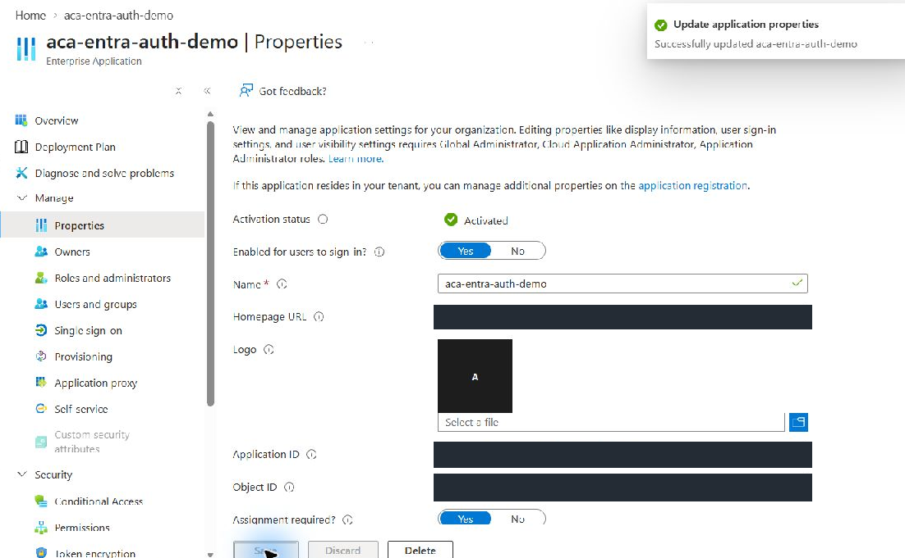

*Entra checks for an application assignment during sign-in.*

### Add the presenter

Open **Users and groups**, then select **Add user/group**.

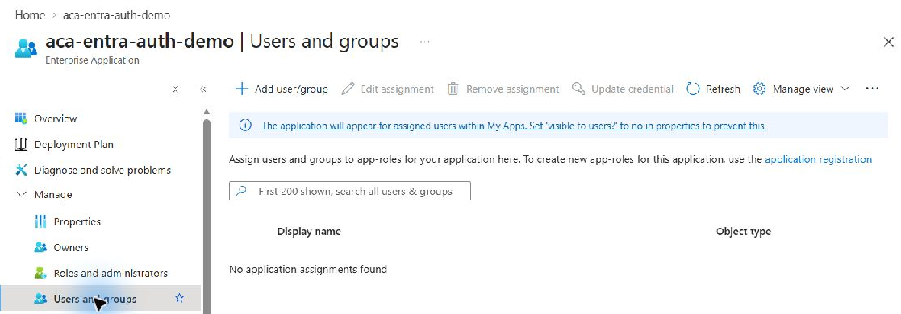

*The new enterprise application starts with an empty assignment list.*

### Select the user

Open the user picker, search for your presenter account, select its row, then choose **Select**.

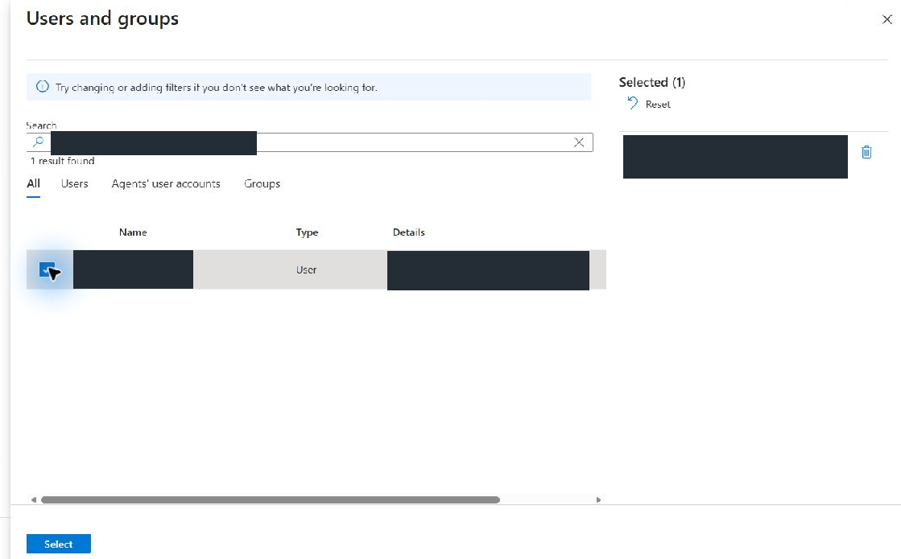

*Use a direct assignment for the presenter account.*

### Save the assignment

In **Add Assignment**, verify that one user is selected and choose **Assign**.

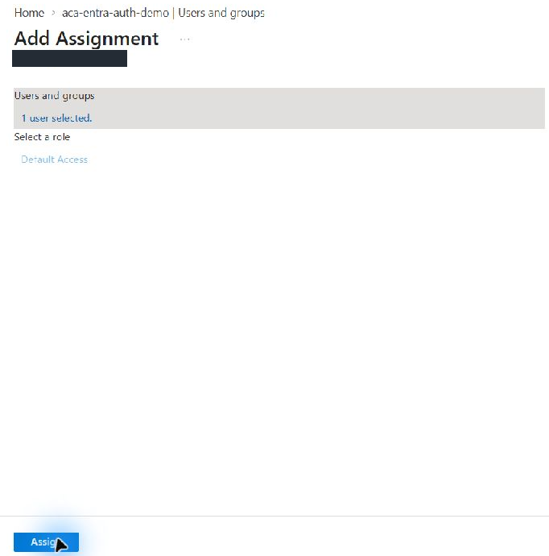

*The presenter receives the Default Access assignment.*

### Confirm the assignment

Check that the user appears under **Users and groups**.

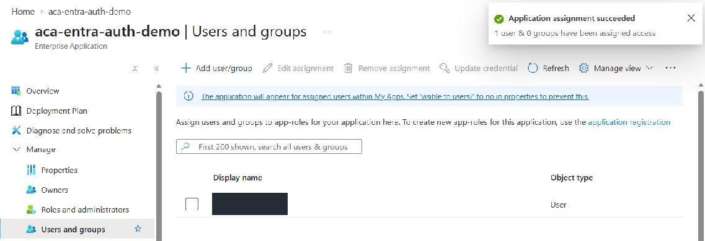

*The application is ready to test with that user.*

## 3. Test the browser flow

### Open the protected app

Open the app URL in an Edge InPrivate window. It should redirect to Microsoft sign-in.

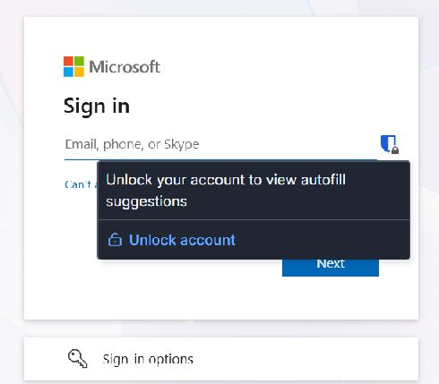

*ACA sends an unauthenticated browser to Microsoft Entra ID.*


### Sign in

Sign in as the assigned presenter and complete any required MFA. If Entra displays a consent prompt, review it and follow your tenant's consent policy.

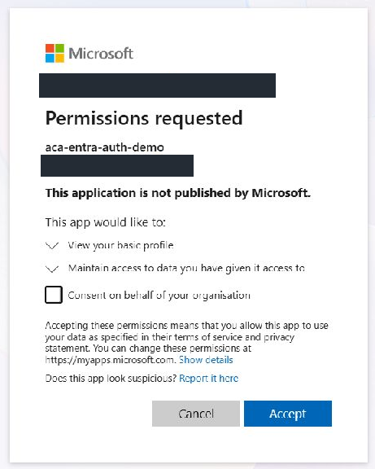

*Entra can request consent the first time the presenter signs in.*

The page reads **Authenticated** and displays a **Sign out** link. The current revision also displays a **Signed-in user** panel with selected platform-provided claims. The panel is a way to explain the identity data that arrives from the ACA authentication layer without exposing bearer tokens.

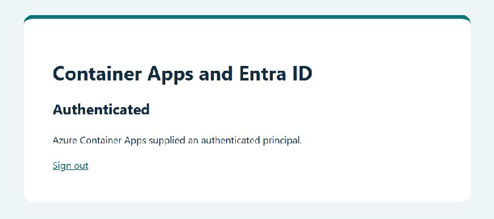

*The initial rehearsal confirmed that ACA passed an authenticated principal to the container.*

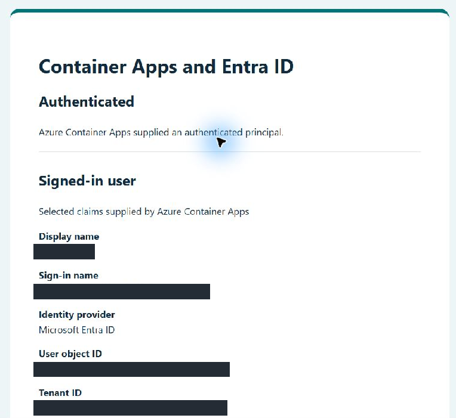

*The verified live revision shows display name, sign-in name, Microsoft Entra ID, user object ID and tenant ID.*

### Sign out

Select **Sign out**. If Microsoft displays an account picker, pick the account to finish signing out. Open the app URL again to check that it initiates a fresh sign-in flow. Close the InPrivate window when finished.

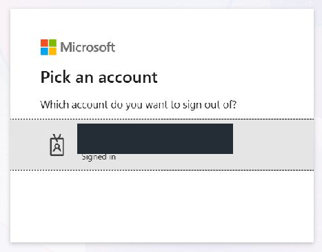

*The ACA logout endpoint starts Microsoft's sign-out flow.*

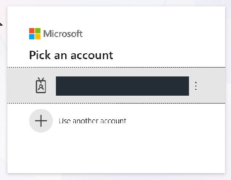

*After sign-out, Edge returned to the Microsoft sign-in gate.*

The registry identity is used when ACA pulls the image. The Entra app registration and enterprise application control the visitor's browser sign-in. The container relies on ACA to enforce authentication and uses the platform-supplied principal headers to display status and a short list of identity claims.

## Presenter run sheet

Allow 15 minutes for the sign-in walkthrough once resources are ready. Start the Azure deployment before class and keep this guide open alongside the portal.

1. Show the ACR image digest and the matching ACA revision. Explain why `AcrPull` belongs to the managed identity.
2. Open the ACA Authentication blade, then open the Entra app registration and enterprise application. Point out where the redirect URI and presenter assignment live.
3. Open a clean Edge InPrivate session. Show the sign-in gate, sign in as the assigned presenter, point to **Authenticated**, and sign out.

## Troubleshooting and upkeep

- For an image-pull failure, compare the revision's image digest with the ACR digest, check registry ARM-audience authentication and confirm the registry-scoped `AcrPull` assignment. Wait for role propagation before retrying.
- For a sign-in failure, check the directory, assigned user, callback URL, secret expiry and sign-in logs. Test again in a fresh InPrivate session. Handle any MFA or Conditional Access prompts through your organisation's normal sign-in flow.
- To rotate the credential, create a new client secret on the demo app registration, update the ACA secret referenced by the Microsoft provider, restart the active revision to load the updated secret, test sign-in in InPrivate, then remove the old credential. Keep the secret value out of terminal logs, screenshots and Git.
- Use **Cost Management > Cost analysis** scoped to the demo resource group. Basic ACR charges while it exists. ACA scales to zero between requests. Requests and registry builds may incur usage charges.
- To tear down, delete the dedicated demo resource group in Azure. Remove the demo app registration separately in Entra and verify the corresponding enterprise application is gone. Keep the repository and walkthrough for future rehearsals.

[Microsoft Entra authentication](https://learn.microsoft.com/en-us/azure/container-apps/authentication-entra) · [Managed identity image pulls](https://learn.microsoft.com/en-us/azure/container-apps/managed-identity-image-pull) · [Container Apps pricing](https://azure.microsoft.com/en-gb/pricing/details/container-apps/) · [Container Registry pricing](https://azure.microsoft.com/en-gb/pricing/details/container-registry/)
